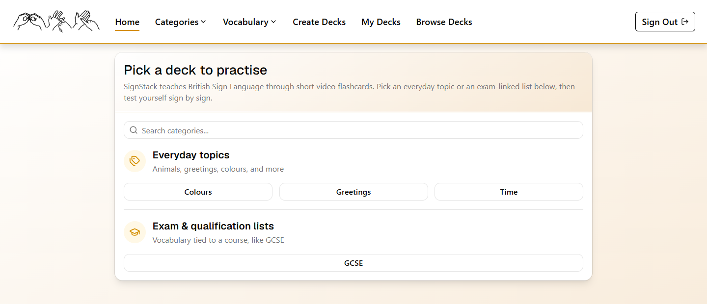
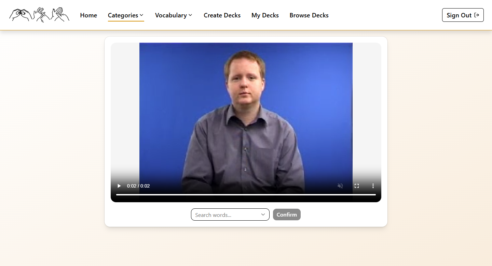
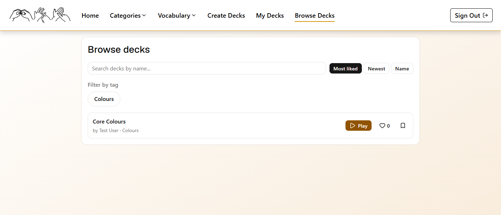

# SignStack


A flashcard web app for learning British Sign Language (BSL): pick a topic, watch a short video of the sign, and guess the word.

My mother is deaf and works as a BSL teacher, which is what gave me the idea for this project. It's also been my vehicle for learning React/Vite properly and for experimenting with disciplined, agentic development workflows (more on that below).



## Features

- **Flashcard practice** — two modes on the same video/guess UI: untimed **Practice**, and a scored **10 Cards** round
- **Built-in vocabulary** — everyday topics (colours, greetings, time) and exam-linked lists (e.g. GCSE), with subcategory filtering
- **Custom decks** — build a deck from the existing word bank, edit it, and play it exactly like a built-in category
- **Publishing & discovery** — publish a deck publicly, browse/filter the directory by tag, like decks, and save others' decks to your own library
- **Role-gated admin** — a two-tier `admin`/`superadmin` system for managing words, sign videos, categories, and user roles/bans





## Engineering highlights

- **RLS as the actual security boundary.** Every table is covered by Postgres Row-Level Security policies; client-side role checks are UX-only and are re-verified server-side in RLS/RPC, not trusted on their own.
- **Atomic multi-row writes via Postgres RPC.** Operations like creating or updating a custom deck write a header row plus its word/tag junction rows in a single transactional function, instead of multiple round-trips that could leave partial state.
- **Two-tier test suite.** A fast Vitest project running in jsdom for most unit/component tests, and a separate project driving real Chromium (via Playwright) for layout- and pointer-dependent cases — routed automatically by filename convention.
- **A workflow built to keep AI-assisted changes disciplined.** This repo is also a testbed for agentic development: a git-hook-enforced workflow (lint, targeted tests, and a docs-sync check) blocks any commit that doesn't keep source and documentation in lockstep — a deliberate answer to "how do you keep Claude-assisted changes from drifting," reasoned through (including rejected alternatives) in [`docs/workflow-automation.md`](./docs/workflow-automation.md).

See [`/docs`](./docs/README.md) for the full hand-maintained wiki — architecture, every RLS policy and RPC function with its live SQL, component/hook reference, and the documentation/testing conventions above.

## Stack

- **Frontend:** React 19 + TypeScript + Vite
- **Backend:** Supabase (Postgres, Auth, RLS, RPC/Postgres functions, Storage) — run locally via Docker during development
- **Package manager:** npm

## Getting started

Runs locally only for now — there's no hosted deployment.

1. Install dependencies:
   ```
   npm install
   ```
2. Start the local Supabase stack (Docker must be running):
   ```
   npx supabase start
   ```
   This prints a local API URL and anon key. Create `.env.local` with:
   ```
   VITE_SUPABASE_URL=<local API URL>
   VITE_SUPABASE_ANON_KEY=<local anon key>
   ```
   (see `src/vite-env.d.ts` for the expected shape)
3. Apply migrations and seed sample data (including sign videos):
   ```
   npm run db:reset:seeded
   ```
4. Start the dev server:
   ```
   npm run dev
   ```

## Scripts

| Command | Description |
| --- | --- |
| `npm run dev` | Start the Vite dev server |
| `npm run build` | Type-check and build for production |
| `npm run lint` | Run ESLint |
| `npm run test` | Run the unit test suite (Vitest) |
| `npm run preview` | Preview the production build locally |
| `npm run db:reset:seeded` | Reset the local Supabase DB and seed sample data/videos |
| `npm run setup-hooks` | Point git at the repo's `.githooks` directory |
| `npm run test-hooks` | Verify git hook enforcement is wired up correctly |

## Database

`supabase/migrations/` is the source of truth for schema, RLS policies, and RPC functions.

## License

[MIT](./LICENSE)
