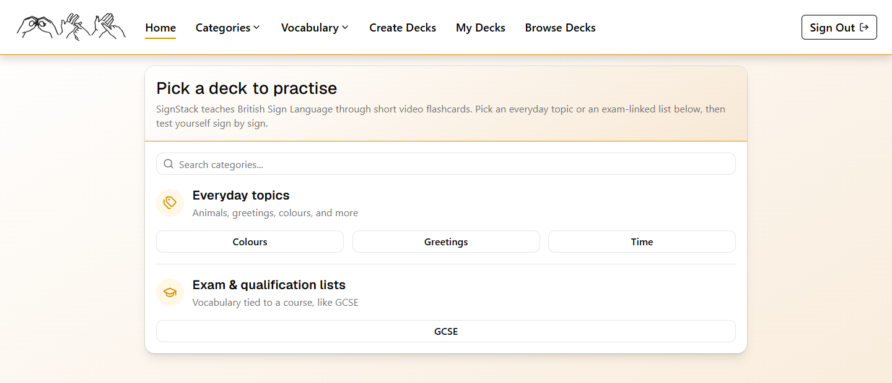
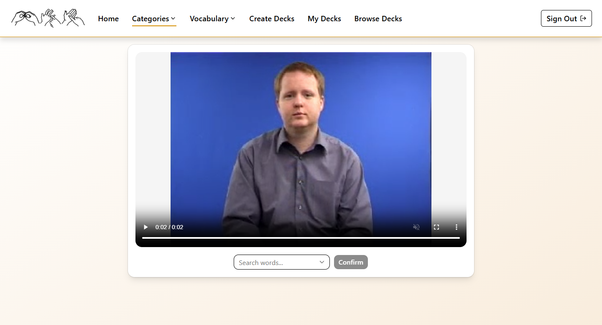
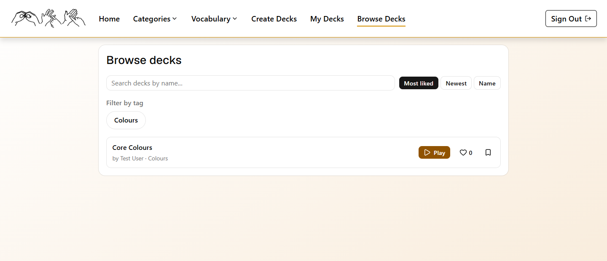

# BSLFlash

A flashcard web app for learning British Sign Language (BSL): pick a topic, watch a short video of the sign, and guess the word.

**Live app: [bslflash.vercel.app](https://bslflash.vercel.app/)**

My mother is deaf and works as a BSL teacher, which is what gave me the idea for this project. It's also been my vehicle for learning React/Vite properly and for experimenting with disciplined, agentic development workflows (more on that below).

## Features

- **Flashcard practice** — two modes on the same video/guess UI: untimed **Practice**, and a scored **10 Cards** round
- **Built-in vocabulary** — everyday topics (colours, greetings, time) and exam-linked lists (e.g. GCSE), with subcategory filtering
- **Custom decks** — build a deck from the existing word bank, edit it, and play it exactly like a built-in category
- **Publishing & discovery** — publish a deck publicly, browse/filter the directory by tag, like decks, and save others' decks to your own library
- **Installable PWA** — install it to your home screen or desktop from the in-app prompt
- **Role-gated admin** — a two-tier `admin`/`superadmin` system for managing words, sign videos, categories, and user roles/bans

## Engineering highlights

- **RLS as the actual security boundary.** Every table is covered by Postgres Row-Level Security policies; client-side role checks are UX-only and are re-verified server-side in RLS/RPC, not trusted on their own.
- **Separate staging and production environments.** Each runs its own hosted Supabase project paired with a matching Vercel environment. Database migrations are deployed by GitHub Actions, production migrations wait behind a manual approval gate, and CI (lint, build, tests) must pass before anything merges into `main`.
- **Atomic multi-row writes via Postgres RPC.** Operations like creating or updating a custom deck write a header row plus its word/tag junction rows in a single transactional function, instead of multiple round-trips that could leave partial state.
- **Two-tier test suite.** A fast Vitest project running in jsdom for most unit/component tests, and a separate project driving real Chromium (via Playwright) for layout- and pointer-dependent cases — routed automatically by filename convention.
- **A workflow built to keep AI-assisted changes disciplined.** This repo is also a testbed for agentic development: a git-hook-enforced workflow (lint, targeted tests, and a docs-sync check) blocks any commit that doesn't keep source and documentation in lockstep — a deliberate answer to "how do you keep Claude-assisted changes from drifting," reasoned through (including rejected alternatives) in [`docs/workflow-automation.md`](./docs/workflow-automation.md).

See [`/docs`](./docs/README.md) for the full hand-maintained wiki — architecture, every RLS policy and RPC function with its live SQL, component/hook reference, and the documentation/testing conventions above.

## Stack

- **Frontend:** React 19 + TypeScript + Vite, styled with Tailwind CSS v4 and shadcn/ui
- **Data & routing:** TanStack Query, React Router
- **PWA:** vite-plugin-pwa
- **Backend:** Supabase (Postgres, Auth, RLS, RPC/Postgres functions, Storage)
- **Hosting:** Vercel (frontend), Supabase (backend), GitHub Actions (CI, migrations, keep-alive) — details in [`docs/deployment/`](./docs/deployment/README.md)

## Running locally

Want to run your own copy? See [`docs/local-development.md`](./docs/local-development.md).

## License

[MIT](./LICENSE)
